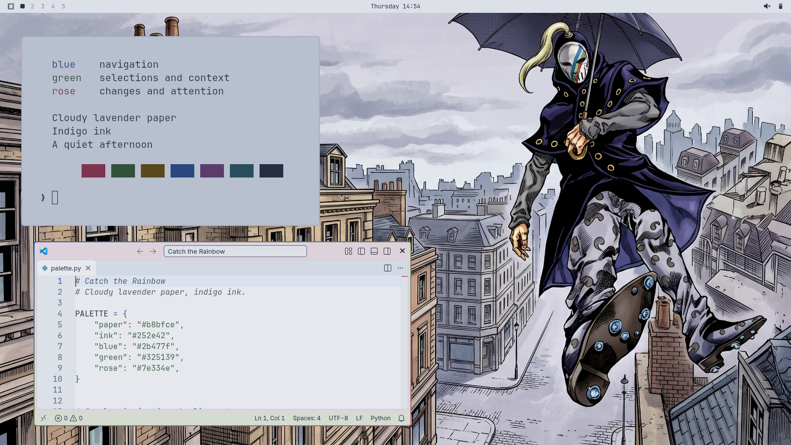

# Catch the Rainbow

A soft light theme for Omarchy, inspired by Blackmore and *Steel Ball Run*: cloudy lavender paper, indigo ink, and blue, green and rose accents from the Catch the Rainbow mask.



## Install

```sh
omarchy theme install https://github.com/agriby-chaniago/omarchy-catch-the-rainbow-theme
```

Tested with **Omarchy 4.0.6-1**, Hyprland 0.56.2 and Quickshell 0.3.2. This is a public beta; compatibility with other Omarchy releases has not been verified.

The standard theme uses Omarchy's native palette and templates. It includes the wallpaper, light terminal/editor colors, shell surfaces, rose hover/focus states, sage selections, and the three-color window border. It uses the standard Yaru-blue icon fallback. Existing widgets, plugins and keybindings stay under your control.

## Optional full desktop

The [beta release](https://github.com/agriby-chaniago/omarchy-catch-the-rainbow-theme/releases/tag/v1.0.0-beta.1) also provides a separate **full desktop bundle**. It adds weather-driven animated line rain, paper folder icons, an Oreo mask cursor, a custom bar and media panel, notification cards, OSD gauges and app integration.

The full bundle has its own installer, backup journal and restore command. Read [the full-desktop guide](docs/FULL-DESKTOP.md) before choosing it. Its scripts run only when you explicitly download and invoke that installer. The standard install command above installs the native theme.

## Palette

| Role | Color |
|---|---|
| Terminal paper | `#b8bfce` |
| Indigo ink | `#252e42` |
| Navigation blue | `#2b477f` |
| Sage selection | `#a3b39f` |
| Green context | `#325139` |
| Rose actions/errors | `#7e334e` |
| Shell paper | `#dce0e7` |

The main terminal text contrast is 7.35:1 by an sRGB color calculation. Terminal colors are deliberately darker than the shell's paper surfaces to keep long sessions comfortable.

## Support

Please include your Omarchy version, whether you installed the standard theme or the full bundle, and steps to reproduce when [reporting an issue](https://github.com/agriby-chaniago/omarchy-catch-the-rainbow-theme/issues).

This project is maintained on a best-effort basis. [Validation notes](docs/VALIDATION.md) describe what was checked and the limits of those checks.

## Credits

Created for and maintained by [Agriby D. Chaniago](https://github.com/agriby-chaniago). The theme was developed iteratively with AI assistance and personal visual feedback.

Blackmore and Catch the Rainbow are from *JoJo's Bizarre Adventure: Steel Ball Run* by Hirohiko Araki. The wallpaper is AI-generated fan artwork supplied and selected by the theme author. The original selected image is retained. This community theme is not affiliated with the original creators or the Omarchy project.

Original theme configuration and tooling are available under the [MIT license](LICENSE). Artwork and optional third-party components have separate notices in [CREDITS.md](CREDITS.md).
